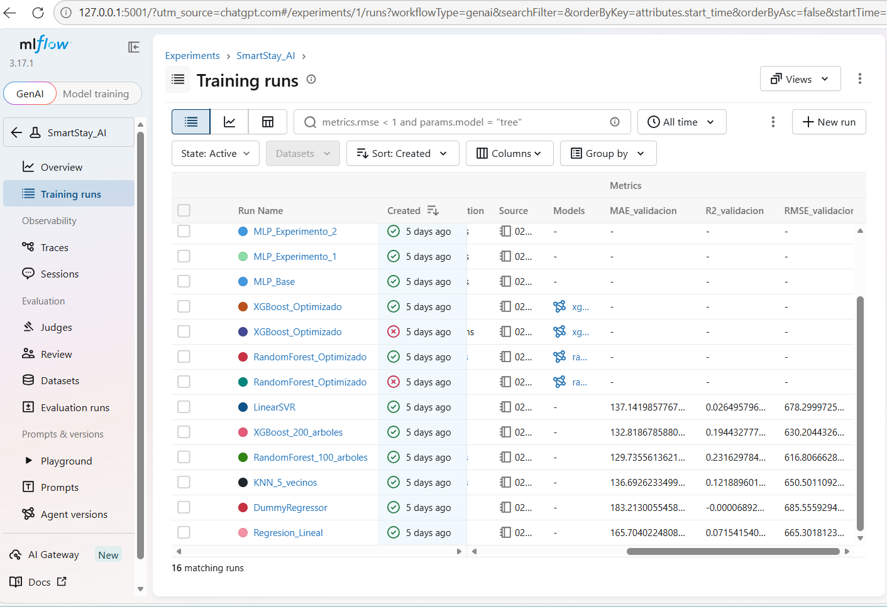
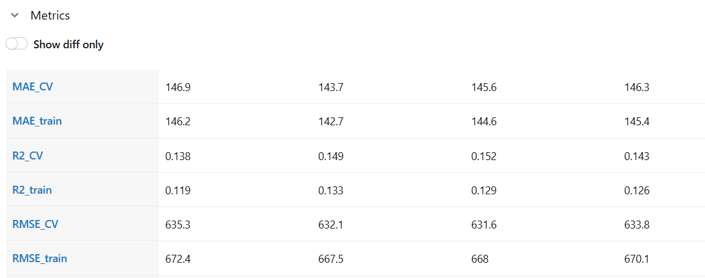
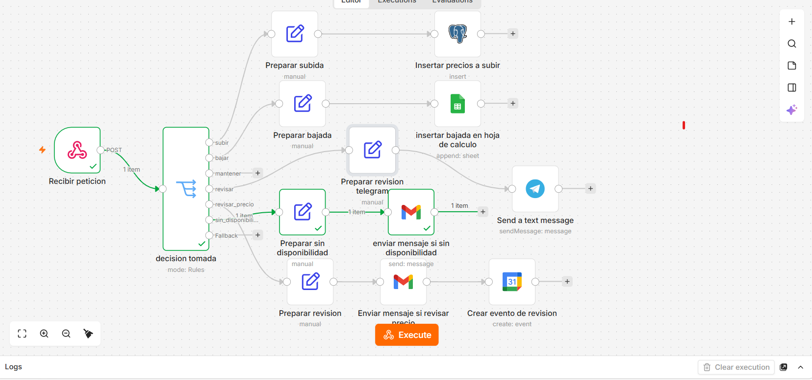
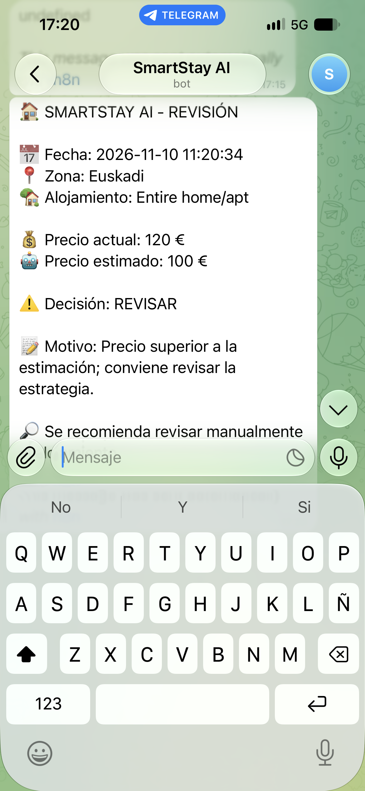
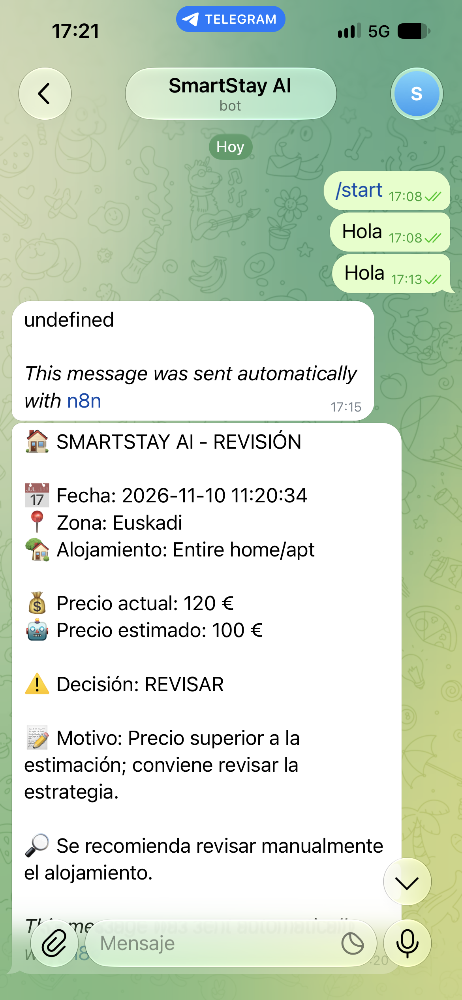

# SmartStay AI — De la predicción a la acción

**Sistema de apoyo a la decisión para estimar precios de alojamientos turísticos en España mediante Machine Learning, reglas de negocio y automatización con n8n.**

**Proyecto académico · Reto 1 (SAA + PIA + MIA) · Curso 2026–2027**

> **Alcance:** SmartStay AI es un prototipo. Sus predicciones son orientativas y **no modifica automáticamente los precios publicados en Airbnb**. La revisión humana sigue siendo necesaria para las decisiones relevantes.

## 1. Objetivo y necesidad de negocio

El proyecto estima el **precio por noche** de un alojamiento turístico a partir de sus características. Después, un motor de reglas compara el precio anunciado con la estimación, la disponibilidad y la actividad reciente para proponer una decisión. Streamlit presenta los resultados y n8n permite registrar recomendaciones, enviar avisos y programar revisiones.

Está orientado a anfitriones y gestores que necesitan referencias para revisar precios y priorizar casos. Las posibles mejoras de eficiencia son objetivos del prototipo, **no beneficios cuantificados**.

## 2. Arquitectura

```text
Datos Airbnb → preparación y entrenamiento → modelo Random Forest guardado
                                                │
Formulario Streamlit → predicción de precio ←─────┘
         │
         ▼
Motor de reglas Python (src/reglas.py)
         │ decisión + motivo + datos
         ▼
HTTP POST → Webhook n8n → Switch → Edit Fields
                                  ├─ SUBIR → PostgreSQL (Neon)
                                  ├─ BAJAR → Google Sheets
                                  ├─ MANTENER → Sin acción externa
                                  ├─ REVISAR → Telegram
                                  ├─ REVISAR PRECIO → Gmail + Google Calendar
                                  └─ SIN DISPONIBILIDAD → Gmail
```

La predicción, las reglas de negocio y las acciones externas son componentes independientes. Cambiar una integración de n8n no requiere reentrenar el modelo.

## 3. Datos y análisis exploratorio

El dataset unificado de anuncios de Airbnb contiene aproximadamente **109.437 registros y 20 columnas**, procedentes de nueve zonas: **Madrid, Girona, Barcelona, Mallorca, Málaga, Sevilla, Valencia, Euskadi y Menorca**.

- **Problema:** regresión supervisada.
- **Variable objetivo:** `price`, precio por noche en euros.
- **Entrenamiento definitivo:** 71.691 registros.
- **Test reservado:** 17.923 registros.
- **Análisis:** valores ausentes, distribución de precios, precios extremos, variables categóricas y relaciones entre características.

El EDA, los criterios de limpieza y las visualizaciones se documentan en los notebooks del proyecto. La procedencia exacta y las condiciones de uso del dataset deben conservarse junto con los datos originales.

### Variables del modelo definitivo

| Tipo            | Variables                                                                                                                                                          |
|-----------------|--------------------------------------------------------------------------------------------------------------------------------------------------------------------|
| Numéricas (8)   | `latitude`, `longitude`, `minimum_nights`, `number_of_reviews`, `reviews_per_month`, `calculated_host_listings_count`, `availability_365`, `number_of_reviews_ltm` |
| Categóricas (3) | `zona`, `room_type`, `estancia_larga`                                                                                                                              |

`estancia_larga` se deriva de `minimum_nights` y señala estancias mínimas de **30 noches o más**. El preprocesamiento utiliza `SimpleImputer`, `StandardScaler` y `OneHotEncoder`. Las 11 variables originales se transforman en **23 columnas** en el análisis SHAP.

## 4. Modelos y experimentos

Se evaluaron cinco familias de modelos: **Regresión Lineal, KNN, Random Forest, XGBoost y SVR**, además de un `DummyRegressor` como referencia. También se realizaron experimentos con **MLP (modelo base y tres variantes)**, optimización de hiperparámetros, tratamiento de precios extremos, selección de variables y modelos especializados. Se utilizó **MLflow** para documentar y comparar experimentos.

### Comparación de experimentos con MLflow

Se utilizó MLflow para registrar los experimentos, sus hiperparámetros y las métricas de evaluación.

#### Comparación de modelos principales



#### Comparación de redes neuronales MLP


#### Métricas de los experimentos MLP



#### Comparación MLP mediante MAE


### Modelo seleccionado

El modelo definitivo es un **Random Forest Regressor general optimizado**, guardado en `models/mejor_modelo.joblib`.

| Parámetro                  | Valor                                     |
|----------------------------|-------------------------------------------|
| Algoritmo                  | `RandomForestRegressor`                   |
| `max_features`             | `0.7`                                     |
| `min_samples_leaf`         | `2`                                       |
| `random_state`             | `42`                                      |
| `n_jobs`                   | `1`                                       |
| Transformación de objetivo | `log1p` al entrenar y `expm1` al predecir |
| Preprocesamiento           | Imputación, escalado y One-Hot Encoding   |
| Variables originales       | 11                                        |

El archivo contiene un `TransformedTargetRegressor` con un pipeline ajustado. **Para obtener predicciones en euros se debe llamar a** `modelo.predict(...)` **con las 11 variables originales**, no directamente al Random Forest interno, que predice en escala logarítmica.

### Evaluación final: test completo

| Métrica | Random Forest general |
|---------|----------------------:|
| MAE     |          **100,87 €** |
| RMSE    |          **322,47 €** |
| R²      |            **0,3973** |

El MAE expresa un error absoluto medio de 100,87 € por noche en el test; el R² indica que el modelo explica aproximadamente el 39,73 % de la variabilidad observada. El RMSE elevado refleja errores grandes, especialmente en alojamientos con precios extremos. **La precisión es moderada y no debe interpretarse como garantía de precio.**

### Validación cruzada y selección de variables

La validación cruzada de tres particiones registró **MAE 109,24 €**, **RMSE 645,32 €** y **R² 0,1885**. Son resultados de otro procedimiento de evaluación y no equivalen a los del test final.

| Configuración           | Variables |   MAE CV |
|-------------------------|----------:|---------:|
| Modelo original         |        11 | 109,24 € |
| Sin latitud ni longitud |         9 | 116,58 € |
| Sin `estancia_larga`    |        10 | 109,21 € |

Eliminar las coordenadas empeora el resultado. La diferencia de 0,03 € al eliminar `estancia_larga` es prácticamente irrelevante; se conserva la configuración de 11 variables del modelo definitivo.

### Comparación con el Random Forest especializado

Se entrenó también un modelo especializado para alojamientos con **precio real ≤ 500 €**.

| Métrica | General: test completo | Especializado: test completo |
|---------|-----------------------:|-----------------------------:|
| MAE     |               100,87 € |                     115,23 € |
| RMSE    |               322,47 € |                     401,46 € |
| R²      |                 0,3973 |                       0,0659 |

| Métrica | General: subconjunto ≤ 500 € | Especializado: subconjunto ≤ 500 € |
|---------|-----------------------------:|-----------------------------------:|
| MAE     |                      54,40 € |                            49,20 € |
| RMSE    |                      85,91 € |                            72,34 € |
| R²      |                       0,2895 |                             0,4963 |

El especializado mejora en ese subconjunto, pero empeora en el test completo. Además, **el precio real no se conoce al predecir un nuevo alojamiento**, de modo que no puede utilizarse para decidir qué modelo aplicar. Por ello, **solo el Random Forest general forma parte del sistema desplegado**.

## 5. Interpretabilidad con SHAP

Se aplicó SHAP al Random Forest general definitivo sobre una muestra reproducible de **50 alojamientos del conjunto de test** (`random_state=42`) y **23 variables transformadas**. Se generaron un gráfico de importancia media absoluta y un gráfico de dispersión (*beeswarm*).

En esa muestra destacan `minimum_nights`, el tipo de alojamiento, la ubicación —incluida Mallorca—, las coordenadas y `availability_365`. Las estancias mínimas elevadas tienden a reducir la predicción, mientras que los alojamientos completos tienden a elevarla; las habitaciones privadas muestran contribuciones negativas en la muestra analizada.

**Interpretación:** SHAP describe las contribuciones a las predicciones del modelo, **no relaciones causales**. Los valores SHAP están en escala `log1p(precio)`, no en euros, y la muestra de 50 registros no permite generalizar automáticamente los resultados a todo el mercado.

## 6. Aplicación Streamlit y motor de reglas

La aplicación Streamlit permite introducir características de un alojamiento, estimar su precio con el modelo general guardado y visualizar la recomendación y el motivo generado por el motor de reglas Python. La lógica de reglas está separada del entrenamiento del modelo.

El motor considera el precio anunciado frente al estimado, la disponibilidad y la actividad reciente. El flujo de n8n contempla **seis decisiones**:

| Decisión             | Significado operativo                             |
|----------------------|---------------------------------------------------|
| `SUBIR`              | Registrar una recomendación orientativa de subida |
| `BAJAR`              | Registrar una recomendación orientativa de bajada |
| `MANTENER`           | No ejecutar acciones externas                     |
| `REVISAR`            | Solicitar revisión manual mediante aviso          |
| `REVISAR PRECIO`     | Avisar y programar revisión de precio             |
| `SIN DISPONIBILIDAD` | Informar de que no hay disponibilidad             |

Las reglas pueden generar motivos y señalar cuándo se requiere revisión humana. **No se modifican anuncios ni tarifas de Airbnb automáticamente.** Para documentar umbrales, prioridades y nombres de pantallas exactos, consultar las versiones definitivas de `src/reglas.py` y de la aplicación Streamlit.

## 7. Integración y automatización con n8n

Se desarrolló un flujo en **n8n 2.43.4, self-hosted local**, accesible en `http://localhost:5678`. Streamlit envía una petición **HTTP POST** con JSON al Webhook `smartstay`, protegido mediante autenticación de cabecera `X-Api-Key`.

| Configuración           | Valor                                          |
|-------------------------|------------------------------------------------|
| Método                  | `POST`                                         |
| Path                    | `smartstay`                                    |
| Autenticación           | Header Auth (`X-Api-Key`)                      |
| URL de pruebas          | `http://localhost:5678/webhook-test/smartstay` |
| URL de producción local | `http://localhost:5678/webhook/smartstay`      |
| Variables de entorno    | `N8N_URL`, `N8N_CABECERA`, `N8N_CLAVE`         |

El nodo de entrada `Recibir peticion` recibe los campos normalmente bajo `body`. El nodo `Switch` evalúa `{{ $json.body.decision }}`. Los nodos **Edit Fields** seleccionan y preparan los datos para cada servicio.

### Acciones de las seis ramas

| Decisión             | Acción en n8n                                                                   |
|----------------------|---------------------------------------------------------------------------------|
| `SUBIR`              | `Preparar subida` → `Insert` en tabla `recomendaciones` de PostgreSQL (Neon)    |
| `BAJAR`              | `Preparar bajada` → `Append Row` en Google Sheets (`SmartStay_Recomendaciones`) |
| `MANTENER`           | Sin nodos posteriores ni acciones externas                                      |
| `REVISAR`            | Preparar mensaje → Telegram (`Send Message`)                                    |
| `REVISAR PRECIO`     | Preparar asunto/mensaje → Gmail → evento en Google Calendar                     |
| `SIN DISPONIBILIDAD` | Preparar correo → Gmail, sin evento de calendario                               |

En PostgreSQL se utiliza `Insert` para añadir nuevas recomendaciones al historial. Google Sheets añade una fila por ejecución. La rama de revisión por Telegram requiere un mensaje preparado en Edit Fields. Gmail y Calendar se utilizan para revisiones de precio que necesitan seguimiento.

### Evidencias visuales del flujo n8n

La siguiente captura muestra el Webhook de entrada, la clasificación de decisiones y las acciones configuradas para las distintas ramas.



### Notificación de revisión recibida en Telegram

En este ejemplo, la rama `REVISAR` comunica un precio anunciado de **120 €**, una estimación de **100 €** y la recomendación de revisión manual.



### Evidencia de la conversación con el bot

La siguiente captura permite comprobar la recepción del aviso automatizado. También contiene un mensaje de prueba anterior (`undefined`), que no corresponde a la notificación final de revisión.



### Ejemplo de JSON enviado

```json
{
  "zona": "Euskadi",
  "tipo_alojamiento": "Entire home/apt",
  "precio_actual": 120,
  "precio_predicho": 100,
  "precio_sugerido": null,
  "decision": "REVISAR",
  "motivo": "Conviene revisar la estrategia",
  "reglas_aplicadas": ["R5", "R10", "R11"],
  "revision_necesaria": true
}
```

Este JSON es **un ejemplo de contrato**, no una ejecución real ni una prueba de que esas reglas concretas se activen con esos precios.

### Pruebas de integración

Según la memoria técnica, **las seis ramas se probaron** mediante peticiones de Postman y recorridos desde Streamlit. Se verificaron inserciones en PostgreSQL, filas añadidas a Google Sheets, mensajes de Telegram, correos y eventos de Google Calendar.

Se resolvieron incidencias relacionadas con la operación `Insert` frente a `Upsert`, el Chat ID de Telegram, el requisito de HTTPS para `Telegram Trigger` y campos `mensaje` no definidos. Las pruebas directas desde Postman validan el flujo, pero **no sustituyen las pruebas extremo a extremo** si se modifica el JSON o el motor de reglas.

### Seguridad y límites de la automatización

- Mantener claves, tokens y credenciales fuera del repositorio.
- El Webhook usa autenticación por cabecera; no exponer públicamente un n8n local sin HTTPS y controles de acceso adecuados.
- El sistema **no ejecuta cambios automáticos de precio en Airbnb**.
- En procesos masivos deben filtrarse casos para evitar notificaciones y registros excesivos.
- Los servicios externos dependen de conexión y de sus APIs.

## 8. Organización del proyecto y reproducción

La organización de trabajo descrita durante el desarrollo incluye:

```text
SmartStay_AI/
├── app/                       # Aplicación Streamlit
├── data/
│   ├── raw/                   # Datos originales
│   └── processed/             # Datos preparados (incluido X_test.csv)
├── models/
│   └── mejor_modelo.joblib    # Random Forest general definitivo
├── notebooks/                 # EDA, entrenamiento, evaluación y SHAP
├── src/                       # Funciones auxiliares y reglas de negocio
├── resultados/                # Gráficos y evidencias
├── n8n/                       # Workflow y recursos de automatización
└── README.md
```

> **Nota:** este árbol es una guía basada en la estructura documentada; comprobar los nombres reales antes de publicar el repositorio. No se ha verificado que todos los archivos estén presentes.

### Dependencias principales

`python`, `pandas`, `numpy`, `scikit-learn`, `xgboost`, `shap`, `matplotlib`, `mlflow`, `joblib`, `streamlit` y `requests`. El flujo n8n requiere además su instalación y credenciales válidas para los servicios externos. **Las versiones exactas deben obtenerse del entorno y de los archivos reales del proyecto.**

### Ejecución general

1. Disponer de los archivos del proyecto y del modelo guardado `models/mejor_modelo.joblib`.
2. Crear/activar un entorno Python e instalar las dependencias verificadas del proyecto.
3. Configurar las variables de entorno de la integración sin publicar secretos:

   ```dotenv
   N8N_URL=http://localhost:5678/webhook/smartstay
   N8N_CABECERA=X-Api-Key
   N8N_CLAVE=REEMPLAZAR_CON_SECRETO_PROPIO
   ```
4. Iniciar n8n, importar/activar el workflow correspondiente y configurar las credenciales de cada servicio.
5. Iniciar la aplicación Streamlit con la **ruta real del script principal** y probar una predicción.
6. Verificar el recorrido Streamlit → Webhook → Switch → rama correspondiente.

La URL `/webhook-test/smartstay` sirve para pruebas mientras el Webhook escucha; `/webhook/smartstay` requiere el workflow activo. **No es necesario reentrenar** para utilizar el modelo `.joblib` ya ajustado.

## 9. Evidencias y archivos que deben acompañar la entrega

- Notebooks con EDA, comparación de modelos, experimentos MLP, métricas y gráficos SHAP.
- Modelo definitivo `models/mejor_modelo.joblib`, o instrucciones para obtenerlo si el repositorio no admite su tamaño.
- Código real de Streamlit y `src/reglas.py`.
- Workflow exportado de n8n, **sin credenciales ni secretos**.
- Capturas de MLflow y del flujo n8n enlazadas en este README; añadir las de Streamlit y SHAP si se requieren para la entrega.
- Procedencia/licencia del dataset y dependencias reproducibles.

**Pendiente de verificar antes de publicar:** rutas y nombres exactos de los scripts, archivo de dependencias, exportación del workflow y otras evidencias de la entrega. Las tres capturas de n8n/Telegram están enlazadas desde `resultados/`.

## 10. Limitaciones y mejoras futuras

- **Precisión moderada:** MAE de 100,87 € y R² de 0,3973 en test completo.
- **Precios extremos:** generan errores importantes y elevan el RMSE.
- **Información incompleta:** faltan posibles predictores como equipamiento, calidad, estacionalidad y proximidad a atractivos turísticos.
- **Cambios de mercado:** sería necesario actualizar los datos y reevaluar periódicamente el modelo.
- **Interpretabilidad muestral:** SHAP se ha calculado sobre 50 alojamientos, no sobre todo el test.
- **Entorno local:** la automatización necesita conectividad y un despliegue seguro si se publica.
- **Escalabilidad:** convendría incorporar control de errores, reintentos, trazabilidad y estados de seguimiento de las recomendaciones.

## 11. Conclusión

**SmartStay AI** integra un ciclo completo de aprendizaje supervisado: preparación de datos, comparación y optimización de modelos, evaluación en test, interpretación mediante SHAP y utilización del modelo general en Streamlit. El motor de reglas traduce la predicción en una recomendación y **n8n conecta esas decisiones con registros, avisos y revisiones programadas**.

El resultado es un **prototipo funcional de apoyo a la decisión**, con limitaciones explícitas y supervisión humana. El **Random Forest general** es el único modelo predictivo desplegado; el especializado se conserva únicamente como experimento comparativo.

---

**Documentación técnica complementaria:** `Memoria_Tecnica_n8n_SmartStay_AI.pdf` (configuración detallada, ramas, incidencias y pruebas de integración).

https://github.com/jagoher/SmartStay_AI.
